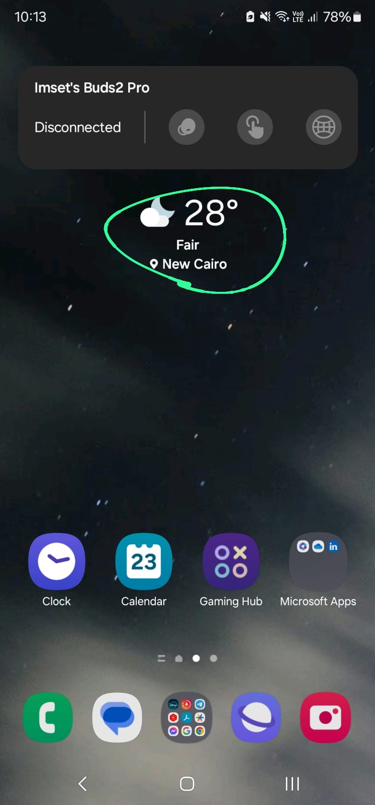
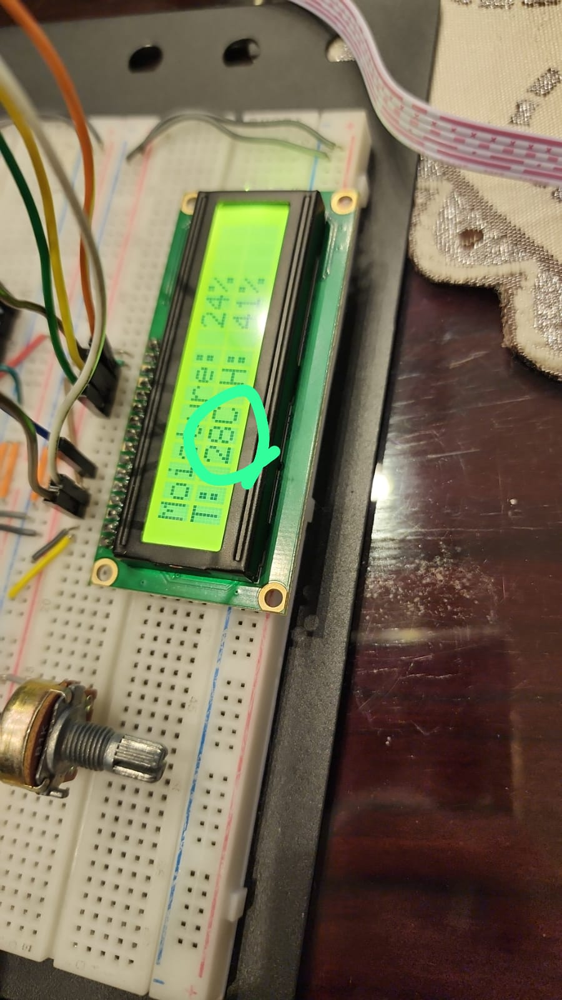
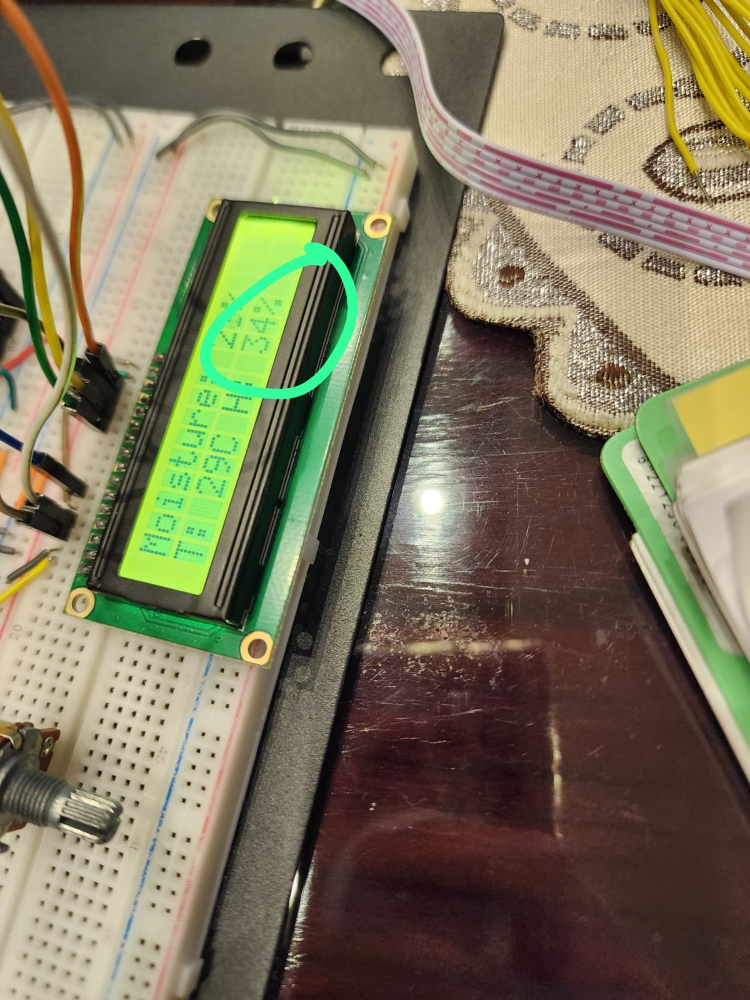
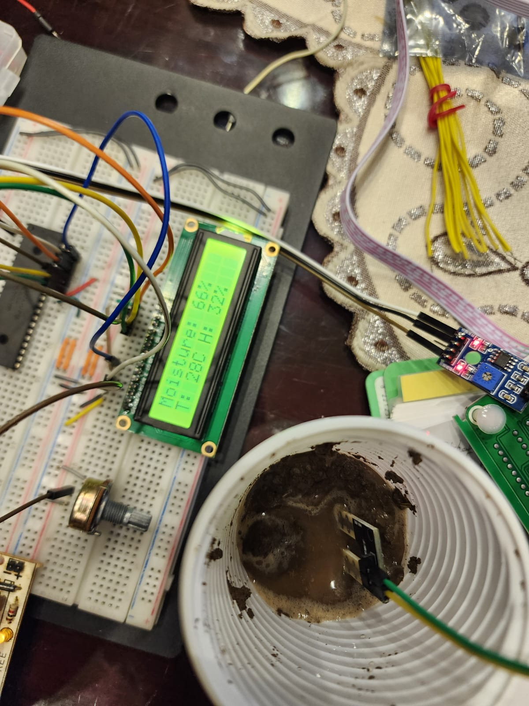

# PIC16F877A Soil Moisture, Temperature and Humidity Monitor

## Overview

A microcontroller-based data acquisition project using a PIC16F877A to read soil moisture, air temperature and relative humidity and show the readings on an LCD. The project was written in **mikroC PRO for PIC** and includes a **Proteus** simulation design.

The source code and project files in this repository were retained from the original university project. The C source has not been modified for this portfolio upload.

## Features

- Reads an analogue soil-moisture sensor through the PIC's ADC on **RA0/AN0**.
- Converts the ADC reading to an approximate 0–100 scale and displays it with a `%` sign.
- Reads **temperature** and **relative humidity** from a **DHT11** on **RD0**.
- Checks the DHT11 data checksum before displaying temperature and humidity.
- Displays readings on a character LCD using the PIC's PORTB pins.
- Includes mikroC project files and a Proteus simulation project.

## Tools and hardware

- **Microcontroller:** Microchip PIC16F877A
- **Clock setting:** 20 MHz in the mikroC project configuration
- **Programming:** mikroC PRO for PIC (PIC-specific C syntax and libraries)
- **Simulation:** Proteus 8 project (`sensors.pdsprj`)
- **Sensors:** analogue soil-moisture sensor and DHT11 temperature/humidity sensor
- **Display:** 16×2 character LCD (LM016L in the Proteus design)

## Pin mapping

| Component / signal | PIC16F877A connection |
| --- | --- |
| Soil-moisture analogue signal | RA0 / AN0 |
| DHT11 data | RD0 |
| LCD D4, D5, D6, D7 | RB0, RB1, RB2, RB3 |
| LCD RS | RB4 |
| LCD Enable | RB5 |

## How the software works

1. Initialise the LCD and ADC.
2. Read ADC channel 0 and calculate `(ADC_reading * 100.0) / 1024.0`.
3. Display the calculated moisture value on the first LCD row.
4. Send a DHT11 start pulse and read humidity and temperature bytes.
5. Check the DHT11 checksum. If valid, display the integer temperature and relative humidity on the second LCD row.
6. Delay and repeat the readings.

### Measurement note

The moisture reading is a **scaled ADC value**, not a calibrated measurement of soil water content. Actual moisture percentages require calibration for the specific sensor and soil. The code displays integer parts of the DHT11 values.

## Project files

| File | Purpose |
| --- | --- |
| `soilsesnsor.c` | Original PIC firmware source code |
| `soilsesnsor.mcppi` | mikroC PRO for PIC project configuration |
| `soilsesnsor.cfg` | PIC configuration flags |
| `soilsesnsor.hex` | Compiled firmware image supplied with the project |
| `sensors.pdsprj` | Proteus project containing the circuit design |

The spelling `soilsesnsor` is retained from the original project to preserve its file references.

## Opening the project

1. Open `soilsesnsor.mcppi` in **mikroC PRO for PIC**. The configured device is PIC16F877A, with a 20 MHz clock. Compile the project if the appropriate software is installed.
2. Open `sensors.pdsprj` in **Proteus**.
3. In Proteus, check the PIC16F877A's **Program File** property and point it to the local `soilsesnsor.hex` file. The original design contains a path from the original development computer, which may not work elsewhere.
4. The Proteus design also references a third-party **Soil Moisture Sensor** model with a library firmware file named `SoilMoistureSensor2TEP.HEX`. That dependency is **not included** in this repository. You may need to install the corresponding Proteus model and library legally before simulating the entire design.
5. Run the simulation and check the LCD output. The original code and design are supplied for inspection and reproduction, not a guarantee that all dependencies are available on another computer.

## Verification and limitations

- The original mikroC project was successfully compiled and linked for the PIC16F877A microcontroller.
- The repository does not include independent validation measurements or a calibration dataset.
- The DHT11 read routine uses blocking waits rather than timeouts. A missing or unresponsive sensor could cause the firmware to wait indefinitely.
- The firmware displays readings locally on the LCD. There is **no code for exporting readings to a database or file**.

## Skills demonstrated

Embedded C, PIC microcontrollers, analogue-to-digital conversion (ADC), DHT11 communication, LCD interfacing, sensor integration, and circuit simulation.

## Project Demonstration

The following images show the PIC16F877A environmental monitoring project.

### Project Images

### Demonstration Video

Watch the project demonstration:

[Watch the Demonstration Video](media/demonstration-video.mp4)

## Author

Mohamed Hassanien
